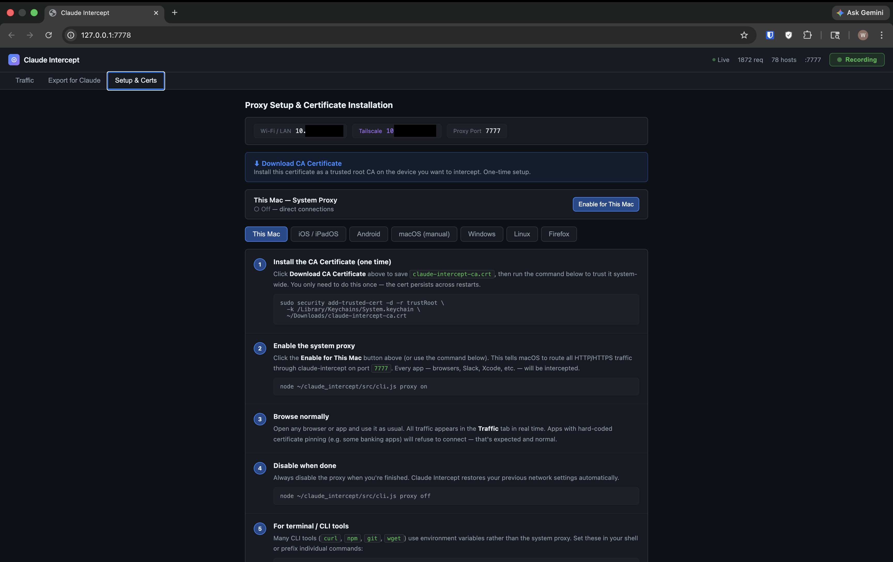

# ⊕ Claude Intercept

A lightweight MITM (man-in-the-middle) proxy for capturing and analyzing HTTP/S traffic — built for use with [Claude Code](https://claude.ai/code) and [Codex](https://developers.openai.com/codex).

Capture traffic from your Mac, iPhone, Android, or any device on your network. Inspect it in a real-time dark-themed dashboard, then analyze discovered APIs, authentication patterns, request patterns, and more. Keep exports containing credential values local.



---

## Features

- **Real-time traffic dashboard** — live request list with method/status badges, body inspection, and header viewer
- **HTTPS interception** — full TLS unwrapping via a per-machine CA certificate (unique to your machine, private key never leaves disk)
- **Multi-device support** — capture from this Mac, iPhone, Android, or any device on the same network or via Tailscale
- **Device labeling** — each request tagged with its source (This Mac, iPhone, iPad, Android, etc.) with a Device filter dropdown
- **Bulk actions** — select, export, or delete multiple requests at once
- **Pause / resume** — stop capturing without interrupting device internet access
- **Claude Code `/intercept` and Codex `$intercept` skill** — start, analyze, and export from the terminal without touching the browser
- **Export modes** — `api-docs`, `auth`, `summary`, `full` — structured output for local or agent-assisted analysis
- **QR code cert install** — scan to install the CA cert on iOS/Android, no typing required
- **Tailscale support** — detects and displays your Tailscale IP for remote device access
- **Zero native compilation** — uses Node.js built-in `node:sqlite` (no `node-gyp`, no Xcode build step)

---

## Requirements

- **Node.js v22.15+** (uses built-in `node:sqlite` — no native compilation needed)
- **macOS or Linux (GNOME/KDE)** for the one-click system-proxy toggle + automated certificate trust; Windows is manual proxy config
- **Claude Code or Codex** for agent-driven capture and analysis (optional; the CLI works independently)

---

## Installation

```bash
git clone https://github.com/whaesemeyer/claude-intercept.git ~/claude_intercept
cd ~/claude_intercept
bash install.sh
```

The installer:
- Verifies Node.js version
- Installs the locked dependency versions with `npm ci --ignore-scripts`
- Installs a shared Intercept skill for Claude Code and Codex
- Links `claude-intercept` to your PATH

Choose one agent, or add skills to an existing installation without reinstalling
dependencies or changing global links:

```bash
bash install.sh --agent codex
bash install.sh --agent claude
bash install.sh --skills-only --agent codex
```

The default is `--agent both`. Claude Code receives
`~/.claude/skills/intercept/SKILL.md`; Codex receives
`~/.agents/skills/intercept/SKILL.md`, its documented user skill location.
See [Codex skill discovery](https://learn.chatgpt.com/docs/build-skills).
Commands are rendered with the absolute checkout path, so either agent can
invoke the CLI from another directory. Re-run the installer after moving the
checkout or updating the skill. Reinstallation replaces this skill's `SKILL.md`;
other skills and agent configuration are left alone.

---

## Quick Start

### Option A — Claude Code skill

In any Claude Code session:
```
/intercept
```
Claude will check proxy state, start it when needed, and guide you through setup.

### Option B — Codex skill

In Codex CLI or the IDE extension, invoke:

```text
$intercept capture traffic from my browser
```

You can also select it with `/skills`. In the ChatGPT desktop app, find the
Intercept skill in the **Skills** sidebar and use a local Codex chat. Codex
detects skill changes automatically; restart if the skill is not listed. The
skill uses `start --daemon --no-open`, JSON status,
and host-filtered exports through the local CLI. No Claude installation, model
API key, or MCP configuration is needed. Local shell and network access are
required; a remote Codex environment cannot capture your local browser unless
you explicitly route its traffic to that proxy.

For example: `$intercept capture a fresh sign-in session from my browser and
verify that the new requests succeed`. The skill checks capture timestamps and
keeps credential values out of chat. Installing a skill alone does not enable
the system proxy or install certificate trust.

### Option C — CLI

```bash
claude-intercept start
```

This starts:
- **Proxy** on `http://127.0.0.1:7777`
- **Dashboard** on `http://127.0.0.1:7778`

---

## CLI Reference

```
claude-intercept <command> [options]
```

| Command | Description |
|---------|-------------|
| `start` | Start proxy + dashboard for this machine only (opens browser automatically) |
| `start --lan` | Allow LAN devices to use the proxy and download its CA certificate; dashboard stays local |
| `start --proxy-port 9090 --ui-port 9091 --no-open` | Custom ports, no auto-open |
| `start --daemon` | Run detached in the background (logs to `captures/intercept.log`); `stop`/`status` then work from any shell |
| `stop` | Stop a running instance |
| `status` | Check if running, show capture stats |
| `status --json` | Same, as machine-readable JSON (for agents/scripts) |
| `clear` | Delete all captured traffic |
| `devices` | List device labels seen in captured traffic (`--json` for parity) |
| `cert` | Print path to the CA certificate |
| `export --mode api-docs` | Generate endpoint documentation with header names and JSON body structure; URLs and field names may still be sensitive |
| `export --mode auth` | Extract Bearer tokens, cookies, API keys |
| `export` or `export --mode summary` | High-level traffic overview (default; excludes raw URLs, headers, and bodies) |
| `export --mode full --host api.example.com` | Full headers + bodies for one host |
| `export --device iPhone` | Only captures from a given device (see `devices`) |
| `export --after-id 42` | Only captures newer than capture ID 42; use `status --json` to record `stats.lastId` before a test |
| `export --mode summary --json` | Aggregate JSON without captured headers, bodies, or URLs |
| `export --mode api-docs --json` | Structured endpoint JSON with header names and body structure, without header or body values |
| `export --mode auth --json` | JSON-wrapped credential findings, without unrelated raw captures |
| `export --mode full --json` | Raw capture JSON, including any credentials present |
| `export --offset 100 --limit 100` | Page through older matching captures; detailed modes cap each page at 25–100 captures |
| `proxy on` | Enable system proxy for a running Intercept instance on macOS or GNOME/KDE; refuses an unrelated active proxy |
| `proxy off` | Disable only Intercept-owned system proxy settings |
| `proxy status` | Show current system proxy state (`--json` for machine-readable) |

---

## Setup by Device

### This Mac

1. Open the dashboard → **Setup & Certs** tab
2. Click **Enable for This Mac** — macOS will prompt for your password
3. Browse normally — all HTTP/S traffic is now captured

Normal shutdown disables only system proxy settings still owned by this
Intercept instance. If the machine or process exits unexpectedly, run
`proxy off` before using a direct connection.

### This Machine (Linux — GNOME / KDE)

Linux is first-class: the proxy toggle and certificate trust are both automated.

1. Open the dashboard → **Setup & Certs** tab (it auto-selects the Linux guide)
2. Click **Install & Trust CA** — installs the CA into the system trust store
   (sudo via your desktop's polkit dialog), auto-installs `certutil`
   (`libnss3-tools`) if missing, and trusts the cert for Chrome/Chromium and
   Firefox. Or run it from the CLI (terminal sudo prompt):
   ```bash
   node ~/claude_intercept/src/cli.js trust
   ```
3. Click **Enable for This Machine** (or `node ~/claude_intercept/src/cli.js proxy on`)
   — toggles the GNOME (`gsettings`) or KDE (`kwriteconfig`) system proxy
4. Browse normally — all HTTP/S traffic is now captured

Reverse the trust changes any time with the **untrust** command — it removes the
CA from the system store and the Chrome/Firefox NSS databases:
```bash
node ~/claude_intercept/src/cli.js untrust
```

> On a headless box (no GNOME/KDE), `proxy on` falls back to printing the
> `http_proxy`/`https_proxy` export lines and the manual trust commands.
> Some Google-pinned domains fail under any MITM proxy — that's expected.

### iPhone / iPad

Start with `claude-intercept start --lan` (or `start --daemon --lan`) so your
phone can reach the proxy and CA certificate download. If it is already running in local-only
mode, stop it before restarting with `--lan`.

1. Install the CA certificate:
   - In the dashboard **Setup & Certs → iOS/iPadOS**, scan the QR code with your iPhone camera
   - Tap the link in Safari → install the profile in Settings
   - Go to **Settings → General → About → Certificate Trust Settings** → enable Claude Intercept CA
2. Configure proxy: **Settings → Wi-Fi → [network] → Configure Proxy → Manual**
   - Server: your Mac's LAN IP (shown in the dashboard)
   - Port: `7777`
3. Traffic from all iPhone apps now appears in the dashboard

### Android

Start with `claude-intercept start --lan` (or `start --daemon --lan`) so your
phone can reach the proxy and CA certificate download.

1. Configure proxy: **Settings → Wi-Fi → long-press network → Modify → Proxy: Manual**
   - Hostname: your Mac's LAN IP
   - Port: `7777`
2. Install the CA cert: open Chrome → navigate to `http://[Mac IP]:7778/api/cert`
   - Install via Settings → Security → Install certificate → CA certificate

### macOS (manual)

System Settings → Network → Wi-Fi → Details → Proxies:
- Enable **Web Proxy (HTTP)** and **Secure Web Proxy (HTTPS)**
- Set both to `127.0.0.1` port `7777`

Install the CA cert:
```bash
sudo security add-trusted-cert -d -r trustRoot \
  -k /Library/Keychains/System.keychain \
  ~/claude_intercept/certs/ca.crt
```

### Windows (manual)

Set the system or browser HTTP and HTTPS proxy to `127.0.0.1:7777`, then
import `certs/ca.crt` into the trusted root certificate store. Automatic
`proxy on` and `proxy off` are unavailable on Windows because this tool cannot
yet verify and preserve every existing Windows proxy setting.

### Firefox

Firefox uses its own cert store. Install via:
**Settings → Privacy & Security → View Certificates → Authorities → Import**

Select `~/claude_intercept/certs/ca.crt` and trust it for websites.

---

## Analyzing Traffic with an Agent

### From the dashboard

1. Check the boxes next to requests you want to analyze
2. Click **Export Selected →** → choose an export mode → **Generate Export**
3. Review the output. Share only the summary or a redacted detailed export with an agent.

### From Claude Code or Codex CLI

```text
/intercept
$intercept
```
Then ask the agent:
- *"Analyze the last 50 requests and document all API endpoints"*
- *"Identify which hosts use authentication without showing credential values"*
- *"What authentication pattern is this app using?"*

The skill starts with an aggregate summary. For detailed analysis, it writes
raw exports to a private local file and reports findings without sharing
credential values in chat.

---

## Security & Privacy

- The CA private key is generated once on your machine and stored at `certs/ca.key`. It never leaves your machine and is excluded from git.
- Each machine gets a unique CA — certificates from one installation cannot decrypt traffic intercepted by another.
- All captured data is stored locally in `captures/captures.db` (SQLite), also excluded from git. The database and private keys are owner-only files, but the database is not encrypted; other processes running as your user can read it.
- A new capture database has a 512 MiB page limit. When it fills, the proxy
  keeps forwarding but stops saving new captures; the dashboard shows a
  warning. Clear or delete captures to reuse database pages; this does not
  necessarily shrink the file on disk. Set
  `CLAUDE_INTERCEPT_MAX_CAPTURE_MB` to an integer from 16 to 8192 before
  starting to choose a different limit. Existing larger databases are not
  truncated.
- The proxy and dashboard bind to `127.0.0.1` by default. `start --lan` lets
  other devices use the proxy and download the public CA certificate. The
  dashboard, capture API, and admin routes remain accessible only from this
  machine. LAN mode binds to all network interfaces and the proxy has no
  password. LAN clients can reach public destinations through it, but local and
  private destinations are blocked. Use it only on a trusted network and stop
  it when finished.
- The dashboard has no login. Any local account that can connect to this
  machine's loopback interface can inspect captures and use dashboard controls;
  run it on a trusted single-user workstation.
- API documentation omits captured header and body values, but URL paths,
  hosts, and field names can still be sensitive. Authentication and full
  exports include credential values. Review exports locally before sharing;
  keep authentication and full exports out of agent chats.

> **This tool is for authorized testing and personal use only.** Only intercept traffic from devices and accounts you own or have explicit permission to test.

---

## Architecture

```
claude_intercept/
├── src/
│   ├── cli.js              # Commander-based CLI entry point
│   ├── analyze.js          # Export formatter (api-docs / auth / summary / full)
│   ├── setup_wizard.js     # Per-platform setup instructions
│   ├── system_proxy.js     # macOS/Linux system proxy toggle; Windows manual
│   ├── proxy/
│   │   ├── index.js        # MITM proxy — HTTP forward + CONNECT tunnel + TLS unwrap
│   │   └── cert_manager.js # CA generation + per-host certificate signing (node-forge)
│   ├── storage/
│   │   └── db.js           # SQLite via node:sqlite — captures schema + query API
│   └── ui/
│       ├── server.js       # Express REST API + WebSocket broadcast
│       └── public/
│           └── index.html  # Single-file dashboard (vanilla JS, dark theme)
├── skill.md                # Claude Code /intercept skill definition
├── scripts/install-skills.js # Shared Claude Code/Codex skill installer
├── install.sh              # Installer (deps, skills, PATH link)
├── captures/               # Runtime — SQLite DB (gitignored)
└── certs/                  # Runtime — CA + leaf keys (gitignored)
```

**Key design decisions:**

- **`node:sqlite`** (built-in, Node 22.5+) — zero native compilation, works everywhere without build tools
- **`node-forge`** for certificate generation — pure JS, no OpenSSL dependency
- **Single HTML file** dashboard — no build step, no bundler, easy to audit
- **Pause at capture layer** — proxy keeps forwarding traffic so devices don't lose internet when paused
- **Per-host cert caching** — certs generated on first CONNECT, reused on subsequent connections

---

## Contributing

PRs welcome. Please test against Node 22.5+.

---

## License

[CC BY-NC 4.0](LICENSE) — free for personal and non-commercial use, attribution required.
